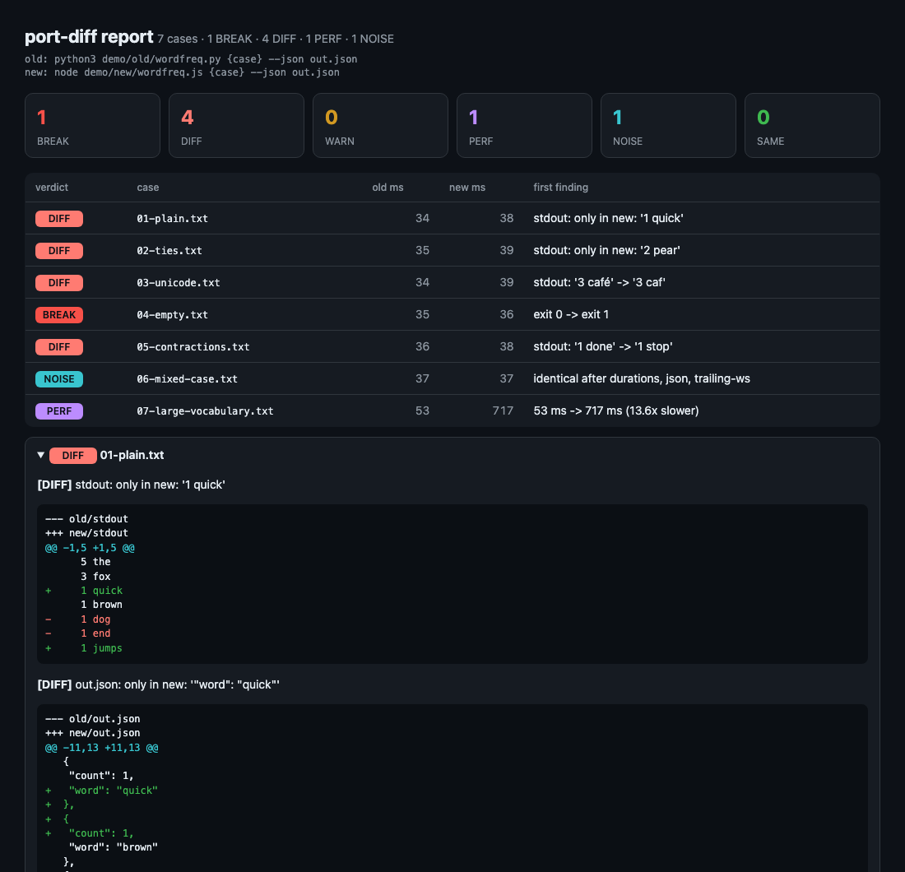

# port-diff

**Your agent ported it. It compiles. The tests are green. Does it still behave the same?**
`port-diff` runs the old and the new implementation on the same inputs, normalizes away noise
(timestamps, temp paths, pointer values, JSON key order…), and grades what actually changed.

   



*The bundled demo: a Python CLI and a plausible agent-written Node port. The port passes a casual
look. port-diff finds a tie-ordering change, a Unicode tokenization bug, a changed exit code on empty
input and a 13x slowdown on a large vocabulary, while ignoring the timing line and JSON key order.*

## Why

Agent-driven rewrites (Zig → Rust, TypeScript → Rust, Go → Rust, whole-game clean-room clones) went
from stunt to routine in a few weeks. The recurring lesson in the write-ups and comment threads is the
same: **compiling and passing the ported test suite is not behavioral equivalence.** The tests were
written for the old code; whatever they don't cover is silently assumed unchanged. Microsoft's
Copilot runtime port, for example, shipped regressions the compiler happily accepted
([DevClass](https://www.devclass.com/devops/2026/09/19/microsoft-agentically-ports-copilot-runtime-to-rust-for-120k/5297592)).

In a port, the old implementation *is* the spec. The cheapest strong check is differential: run both
on lots of real inputs and diff everything observable. People keep hand-rolling this per project
(differential harnesses inside individual ports, RAM-trace comparisons in decompilation projects).
`port-diff` is the reusable version for anything with a command line.

## Quick start

```bash
pipx install git+https://github.com/thinx-pro/port-diff
```

No pipx? `pip install git+https://github.com/thinx-pro/port-diff` works too (zero dependencies).
Then point it at your two builds and a folder of inputs (these paths are examples, use your own):

```bash
port-diff run --old "python3 old/tool.py {case}" --new "./target/release/tool {case}" --cases cases/
```

Try the demo from a clone (needs `python3` and `node`):

```bash
git clone https://github.com/thinx-pro/port-diff && cd port-diff
python3 -m port_diff run --old "python3 demo/old/wordfreq.py {case} --json out.json" \
  --new "node demo/new/wordfreq.js {case} --json out.json" --cases demo/cases --norm json:files --repeat 3
```

Real output:

```text
 DIFF   01-plain.txt               34ms ->     38ms  stdout: only in new: '1 quick'
 DIFF   02-ties.txt                35ms ->     39ms  stdout: only in new: '2 pear'
 DIFF   03-unicode.txt             34ms ->     39ms  stdout: '3 café' -> '3 caf'
 BREAK  04-empty.txt               35ms ->     36ms  exit 0 -> exit 1
 DIFF   05-contractions.txt        36ms ->     38ms  stdout: '1 done' -> '1 stop'
 NOISE  06-mixed-case.txt          37ms ->     37ms  identical after durations, json, trailing-ws
 PERF   07-large-vocabulary.txt    53ms ->    717ms  53 ms -> 717 ms (13.6x slower)

7 cases · 1 BREAK · 4 DIFF · 1 PERF · 1 NOISE
```

followed by unified diffs for every finding. Exit status is `1`, so it works as a CI gate.

## What it compares

For every case, each implementation runs in its **own fresh scratch directory** (the case file or
directory is copied in), so artefacts can't leak between runs. It records:

| observable | how differences are graded |
|---|---|
| exit code, crash signal, timeout | **BREAK** |
| files the old one produced that the new one didn't | **BREAK** |
| stdout | **DIFF** |
| files produced or modified (text diffed, binaries by hash), extra files, deletions | **DIFF** |
| stderr | **WARN** (`--strict-stderr` makes it DIFF) |
| repeated runs of the *same* implementation disagree (`--repeat N`) | **WARN** (nondeterministic: diffs on this case can't be trusted) |
| median wall time, new > 2.0x old *and* ≥ 100 ms slower | **PERF** (`--perf-ratio`, `--perf-min-ms`) |
| byte-different but identical after normalization | **NOISE** (and which rules absorbed it) |
| byte-identical | **SAME** |

## Normalizers

Defaults: `ansi`, `crlf`, `trailing-ws`, `workdir`, `tmpdir`, `timestamps`, `durations`, `addrs`.
Opt-in: `floats=N`, `sort-lines`, `json`, `ws`, `case`. Scope any of them to a stream with
`name:stdout,stderr,files`, add your own with `--sub 'REGEX=>REPLACEMENT'`, drop one with
`--no-norm NAME`, or turn all defaults off with `--raw`. `port-diff run --list-norms` lists them.

Each NOISE verdict names the rules that made it go away, so a too-greedy rule is visible instead of
silently hiding a real change.

## Modes

```bash
# live: both implementations available
port-diff run    --old "OLD {case}" --new "NEW {case}" --cases DIR

# the old binary won't stay runnable (different toolchain, machine, OS): record once, check forever
port-diff record --old "OLD {case}" --cases DIR --out baseline.json
port-diff check  --new "NEW {case}" --cases DIR --baseline baseline.json

# argument-driven CLIs: one case per line
port-diff run --old "old-cli {args}" --new "new-cli {args}" --args-file args.txt
```

Placeholders: `{case}` (path of the copied case), `{name}`, `{args}`, `{here}` (where you ran
port-diff). Relative paths in the command that exist where you run it (`./target/release/tool`,
`old/tool.py`) are made absolute automatically. Other flags: `--stdin` (feed the case as standard
input), `--timeout`, `--jobs`, `--env K=V`, `--ignore-file GLOB`, `--filter`, `--keep`.

Reports: terminal (default), `--json PATH|-`, `--md PATH` (PR comment with collapsible diffs),
`--html PATH` (the screenshot above). `--fail-on break|diff|warn|perf|never` sets the exit status.

## Use it as your porting agent's verifier

`--json -` prints a machine-readable report: verdict, findings and diffs per case. Point your agent at
it after every ported unit. A ready-made Claude Code Skill is in
[`skills/port-verify/SKILL.md`](skills/port-verify/SKILL.md): copy it to `~/.claude/skills/port-verify/`
(or your project's `.claude/skills/`). It tells the agent to treat the old implementation as the spec,
fix the port rather than the cases or the normalizers, and record every intentional behavior change
in `PORTING.md`.

## Limitations and roadmap

- v0.1 covers **command-line behavior**: exit codes, streams, files, wall time. It does not trace
  syscalls, network traffic, memory use or frame timing yet.
- Differential testing only finds differences your inputs trigger. Coverage of the case corpus is on
  you (roadmap: `port-diff cases` helpers to harvest inputs from repos, issues and fuzzers).
- Timing is wall-clock over a few runs; use `--repeat 5` or more, and avoid `--jobs` when PERF matters.
- Planned: domain presets (compiler diagnostics, test-runner output, linters), an MCP server so
  agents can call it as a tool, syscall/file-access traces, memory and timing curves.

## Development

```bash
python3 -m unittest discover -s tests      # stdlib only, no installs
python3 demo/make_cases.py                 # regenerate the demo corpus
```

## License

MIT

---

### 中文说明

**port-diff**：给「Agent 主导的整库移植 / 重写 / 复刻」做行为等价验收。同一批真实输入分别喂给旧实现和新实现（各自在全新临时目录里运行），比较退出码、stdout/stderr、产出文件和耗时；时间戳、临时路径、指针地址、JSON 键顺序等噪音先规范化掉，再把差异分成 BREAK / DIFF / WARN / PERF / NOISE / SAME 六级。支持 `record` 录下旧实现、之后只跑新实现对照；`--json -` 可以直接回灌给移植 Agent 当 Verifier，仓库里附带一个 Claude Code Skill（`skills/port-verify`）。零依赖，Python 3.9+。
